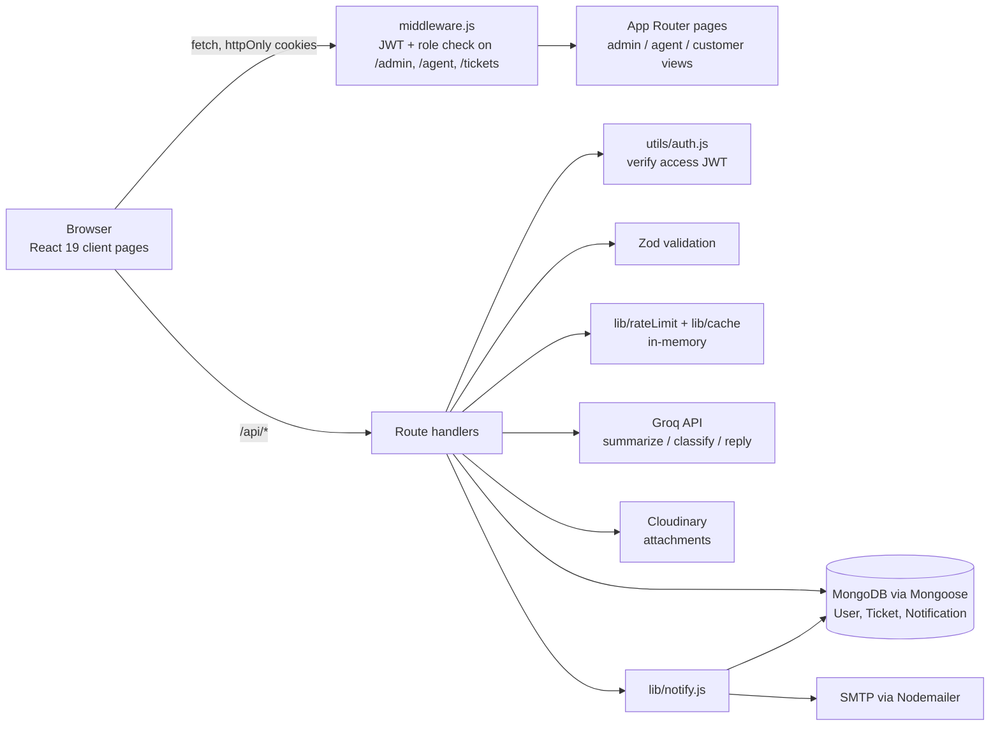

# Ticket System (Next.js + MongoDB + Groq)

A full-stack support desk with admin, agent and customer roles, LLM-powered ticket summaries, file attachments and in-app plus email notifications.

**Live demo:** https://ticket-system-nextjs-kappa.vercel.app

## Why

Small support teams need a single place where customers raise issues, admins triage and assign them, and agents work their queue.
This project builds that loop end to end in one Next.js app, with an LLM helping agents read long tickets faster.

## Key features

- **Three roles: admin, agent, customer.** Customers see only tickets they created, agents see only tickets assigned to them, admins see everything. `middleware.js` gates `/admin/*` and `/agent/*` pages by role, and each API route re-checks the JWT and role.
- **Ticket lifecycle.** Create, search (regex over title and description), filter by status and priority, paginate, comment, and update status/priority. Only admins can assign agents or delete tickets. `resolvedAt` is stamped automatically when a ticket moves to Resolved.
- **Admin dashboard.** Counts by status and priority, tickets per agent (MongoDB aggregation with `$lookup`), and average resolution time in hours, with optional date-range filters. Rendered with Chart.js (pie and bar charts).
- **AI endpoints (Groq, model `openai/gpt-oss-120b` via `groq-sdk`):**
  - `POST /api/ai/summarize` returns a short bullet-point summary. Wired into the agent dashboard and the ticket detail page.
  - `POST /api/ai/classify` returns one category: Technical, Billing, Account, General or Other.
  - `POST /api/ai/reply` drafts a short, polite support reply (temperature 0.4, max 200 tokens).
  - Every endpoint degrades gracefully: on a missing key or provider error it returns a fixed fallback instead of failing the request.
  - `lib/ai.js` holds an alternative helper that calls Groq's OpenAI-compatible REST endpoint with `llama-3.1-8b-instant`, gated by `AI_ENABLED`, with mock responses when disabled.
- **Auth.** Passwords hashed with bcrypt. Login issues a 15-minute access JWT and a 7-day refresh JWT, both in httpOnly cookies. `utils/authFetch.js` retries a request once after calling `/api/auth/refresh` on a 401. Profile page supports name/email update, password change and a logout-all endpoint. Request bodies for auth and tickets are validated with Zod.
- **Rate limiting.** In-memory fixed window (60 requests per minute) on login and register (keyed by IP) and on admin stats (keyed by IP + user).
- **Caching.** In-memory TTL cache for admin stats (120 s, keyed by date filter), an agent's ticket list (30 s) and the agent directory (5 min).
- **Uploads.** Authenticated `POST /api/upload` streams files to Cloudinary (`tickets/` folder) and stores the returned URLs on the ticket.
- **Notifications.** Ticket creation, assignment, status/priority changes, new comments and deletions create a MongoDB notification (list, mark one read, mark all read). Emails are sent via Nodemailer: Gmail SMTP in `lib/notify.js` and a generic SMTP transport in `utils/sendEmail.js`. Both are skipped or fail softly when credentials are not set.

## Architecture



## Tech stack

- **Framework:** Next.js 16 (App Router, route handlers), React 19
- **Data:** MongoDB with Mongoose 9
- **AI:** Groq (`groq-sdk`)
- **Auth:** `jsonwebtoken`, `bcryptjs`
- **Validation and forms:** Zod 4, React Hook Form
- **Files and email:** Cloudinary, Nodemailer
- **UI:** Tailwind CSS 4, Chart.js + react-chartjs-2, Framer Motion, lucide-react, react-hot-toast
- **Hosting:** Vercel

## Project structure

```
app/
  api/
    ai/{classify,reply,summarize}/   LLM endpoints
    auth/{login,logout,me,refresh,register}/
    tickets/  tickets/[id]/  tickets/[id]/comment/
    admin/stats/  agent/tickets/  users/agents/
    notifications/  profile/  upload/
  admin/{dashboard,tickets,create-ticket}/   admin views
  agent/dashboard/                           agent queue
  tickets/  tickets/[id]/                    customer views + ticket detail
  login/  register/  profile/  notifications/
components/skeletons/        loading states
lib/                         db, ai, cache, rateLimit, notify, cloudinary, validations/
models/                      User, Ticket, Notification
utils/                       auth (JWT), tokens, authFetch, sendEmail
middleware.js                page-level auth and role routing
```

## Run locally

Requires Node.js 20+ and a MongoDB instance (local or Atlas).

```bash
git clone https://github.com/yashsharma499/ticket-system-nextjs.git
cd ticket-system-nextjs
npm install
# create .env.local with the variables below
npm run dev
```

Open http://localhost:3000, register an account, and pick a role on sign-up.

Environment variables (names only):

| Variable | Purpose |
| --- | --- |
| `MONGODB_URI` | MongoDB connection string (required) |
| `JWT_SECRET`, `JWT_REFRESH_SECRET` | Access and refresh token signing (required) |
| `GROQ_API_KEY` | Groq API key for AI endpoints (optional, fallbacks apply) |
| `AI_ENABLED` | Set to `true` to enable live calls in `lib/ai.js` |
| `CLOUD_NAME`, `CLOUD_API_KEY`, `CLOUD_API_SECRET` | Cloudinary uploads |
| `EMAIL_USER`, `EMAIL_PASS` | Gmail SMTP for notification emails |
| `MAIL_HOST`, `MAIL_PORT`, `MAIL_USER`, `MAIL_PASS`, `MAIL_FROM` | Generic SMTP for transactional emails |
| `NEXT_PUBLIC_URL`, `NEXT_PUBLIC_BASE_URL` | Base URL used in email links |

Other scripts: `npm run build`, `npm start`, `npm run lint`.

## Possible next steps

- **Use the classify and reply endpoints in the UI.** Auto-fill the category on ticket creation and add a "draft reply" button for agents; both endpoints already exist.
- **Shared state for scale.** Move rate limiting and caching from per-instance memory to Redis so they hold across serverless instances, and add tests for the ticket and auth routes.
